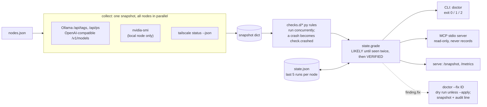

# stack-guardian

[](https://github.com/LuminariSoftwares/stack-guardian/actions/workflows/ci.yml)
[](https://github.com/LuminariSoftwares/stack-guardian/actions/workflows/privacy.yml)

mcp-name: io.github.LuminariSoftwares/stack-guardian

A health doctor for a home AI stack. It collects a snapshot of your nodes (Ollama or OpenAI-compatible endpoints,
loaded models, NVIDIA GPUs, tailnet peers), runs small Python rules against it, remembers the last runs, and reports
findings with a confidence grade: one sample is at most `LIKELY`, the same finding twice in a row is `VERIFIED`. It
exists because "the model is slow" on a multi-machine local stack has a dozen possible causes, and an agent or a person
should get a graded, evidence-backed answer instead of a guess. A finding can carry a typed fix that you run on
purpose, never automatically. It ships as a CLI, an MCP server for coding agents, a tiny HTTP endpoint with Prometheus
metrics, and a DeepSeek Harness (DSH) plugin.

Status: **0.2.1.** Standard library only, Python 3.11+, no runtime dependencies.

## Quick start (60 seconds, offline)

```
pip install stack-guardian
curl -LO https://raw.githubusercontent.com/LuminariSoftwares/stack-guardian/main/examples/snapshot.json
curl -LO https://raw.githubusercontent.com/LuminariSoftwares/stack-guardian/main/examples/ctx.json
stack-guardian doctor --snapshot snapshot.json --ctx ctx.json
```

The example snapshot makes every shipped rule fire once, so you see each finding type without touching a real stack.
The command exits `2` because the example contains FAIL findings; that is the expected result. Point it at your own
machines next: write a nodes file like [examples/nodes.json](examples/nodes.json) and pass it as `--nodes FILE`
(see [What it does](#what-it-does)).

From a clone instead (for writing rules or running the tests):

```
git clone https://github.com/LuminariSoftwares/stack-guardian.git
cd stack-guardian
python -m venv .venv
.venv\Scripts\activate          # Windows;  macOS/Linux: source .venv/bin/activate
pip install -e .
stack-guardian doctor --snapshot examples/snapshot.json --ctx examples/ctx.json
```

## Architecture



| module | job |
|---|---|
| `collect.py`, `multinode.py`, `parsers.py` | probe every node in parallel under one deadline; parse Ollama, OpenAI-compatible, nvidia-smi and tailscale output into one snapshot dict. A dead endpoint is data, never an exception. |
| `core.py`, `finding.py`, `checks.d/` | load rule files, run them concurrently, and build findings with a fixed shape (`code, severity, level, node, summary, evidence, try, confidence, fix`). |
| `state.py` | keep the last runs per node and grade confidence from streaks. |
| `fixes.py` | the three typed fix actions, their dry-run plan, snapshot and audit line. |
| `cli.py`, `mcp_server.py`, `serve.py` | the three front ends over the same doctor. |

### Design decisions

Each is written up with its alternatives in [docs/adr/](docs/adr/).

- **Standard library only** ([ADR 0001](docs/adr/0001-standard-library-only.md)). `pip install` pulls nothing else, so
  it installs on any machine with Python 3.11. Trade-off: the HTTP client, JSON-RPC loop and Prometheus renderer are
  hand-written and have to be tested here.
- **Rules are plain Python files in a folder** ([ADR 0002](docs/adr/0002-rules-as-plain-python-files.md)). A rule is a
  function `(snapshot, ctx) -> finding | list | None`; a rule that raises becomes a `check.crashed` WARN, so a buggy
  rule never reports a broken stack. Trade-off: rules run in-process with your privileges; only load rule folders you
  trust.
- **Confidence from history, not from one sample** ([ADR 0003](docs/adr/0003-confidence-from-run-history.md)). One run
  is at most `LIKELY`; two bad runs in a row are `VERIFIED`. Trade-off: a real outage needs a second run before it is
  `VERIFIED`, and the history is a local file.
- **Typed fixes, dry run by default** ([ADR 0004](docs/adr/0004-typed-audited-fixes.md)). Exactly three actions, never
  a shell string from a rule; nothing changes without `--apply`, and every applied fix leaves a snapshot and an audit
  line. Trade-off: anything outside the three actions has to be done by hand.
- **Agent-facing surfaces are read-only** ([ADR 0005](docs/adr/0005-read-only-agent-surfaces.md)). The MCP server and
  the HTTP endpoint never fix, never write the run history, and `serve` binds to loopback unless told otherwise.
  Trade-off: an agent can diagnose but must hand the fix back to a person.

## For coding agents

- **MCP server** (any MCP client): `stack-guardian-mcp` speaks MCP over stdio with three read-only tools,
  `stack_health`, `stack_snapshot` and `explain`. See [MCP server](#mcp-server) for client configs and the tool
  reference.
- **DSH plugin** (`npm install dsh-stack-guardian`, source in `dsh/`, Node 20+): adds one line at the start of a
  DeepSeek Harness session when the doctor reports WARN or FAIL, and nothing otherwise. It runs
  `stack-guardian doctor --json --quiet`, so set `STACK_GUARDIAN_NODES` to your nodes file in the harness environment.
- **Watching and scraping:** `stack-guardian doctor --watch 30 --json` prints one JSON object per finding that changes
  state (new, resolved, severity change), so an agent can tail it; `stack-guardian-serve --nodes FILE` also answers
  `GET /metrics` in Prometheus text format.

## MCP server

`stack-guardian-mcp` (also `stack-guardian mcp`) speaks MCP over stdio (JSON-RPC 2.0, protocol `2024-11-05`). It needs
a nodes file ([examples/nodes.json](examples/nodes.json)); give its path with `--nodes FILE` or the
`STACK_GUARDIAN_NODES` environment variable. Optional: `--ctx FILE` (rule settings), `--state FILE` (run history to
grade against), `--ttl SECONDS` (how long one snapshot is reused, default 10).

Run it without installing anything:

```
uvx stack-guardian mcp --nodes /path/to/nodes.json
```

**Claude Desktop** (`claude_desktop_config.json`):

```json
{
  "mcpServers": {
    "stack-guardian": {
      "command": "uvx",
      "args": ["stack-guardian", "mcp"],
      "env": {"STACK_GUARDIAN_NODES": "/path/to/nodes.json"}
    }
  }
}
```

**Claude Code:**

```
claude mcp add stack-guardian -e STACK_GUARDIAN_NODES=/path/to/nodes.json -- uvx stack-guardian mcp
```

**Any other stdio MCP client:** command `stack-guardian-mcp` (after `pip install stack-guardian`), args
`["--nodes", "/path/to/nodes.json"]`, or command `uvx` with args `["stack-guardian", "mcp", "--nodes",
"/path/to/nodes.json"]`.

**Docker** (the image bakes in [examples/nodes.json](examples/nodes.json); mount your own over it):

```
docker build -t stack-guardian .
docker run -i --rm -v /path/to/nodes.json:/config/nodes.json:ro stack-guardian
```

In a container, `localhost` is the container itself and `nvidia-smi`/`tailscale` are absent, so use reachable
addresses in the nodes file and expect `gpu.unavailable`/`tailnet.unavailable` for nodes marked `local`.

### Tool reference

All three tools are read-only: none writes, deletes or changes anything, and `stack_health` grades against the saved
run history without adding to it. Generated from the live schemas by `python scripts/tool_reference.py --write`; a test
fails if this section and the code disagree.

<!-- tool-reference:start (generated by scripts/tool_reference.py; do not edit by hand) -->

#### `stack_health` - Stack health

Grade the health of a home AI stack: runs the health rules over every node's Ollama endpoints, loaded models, NVIDIA GPUs and tailnet peers. When to use: call this first to answer "is my stack healthy?" or "why is my model slow or missing?". Use stack_snapshot instead when you need the raw data behind a finding, and explain to learn what one finding code means and how to settle it. Behaviour: read-only and needs no credentials. It probes the nodes over the network (HTTP to Ollama, nvidia-smi and tailscale on the host), reuses one snapshot for 10 seconds, and grades against the saved run history without writing to it, so calling it repeatedly changes nothing. Returns JSON: {node, status: "ok"|"warn"|"fail", counts: {FAIL, WARN, INFO, OK}, findings: [{code, level, severity, node, summary, evidence, try, confidence: "VERIFIED"|"LIKELY"|"INSUFFICIENT", fix}]}; a healthy stack returns status "ok" and no WARN or FAIL findings.

Annotations: `readOnlyHint: true`, `destructiveHint: false`, `idempotentHint: true`, `openWorldHint: true`

| parameter | type | required | default | constraints | example |
|---|---|---|---|---|---|
| `node` | string | no | `""` | maxLength `200` | `gpu-box` |

#### `stack_snapshot` - Stack snapshot

Return the raw snapshot the health rules read: per node, its Ollama endpoints and loaded models, NVIDIA GPUs with VRAM use and processes, and tailnet peer state. When to use: as evidence when a stack_health finding needs checking, or to answer a factual question ("which models are loaded on gpu-box?", "how much VRAM is free?"). Use stack_health instead for graded verdicts and what to try, and explain for the meaning of one finding code. Behaviour: read-only and needs no credentials. It probes the nodes over the network and reuses one snapshot for 10 seconds, so repeated calls within that window return identical data; it writes nothing. Returns JSON: {taken_at, nodes: {<name>: {reachable, ollama: [...], gpus: [...], tailnet: {...}}}}; with an unknown node it returns {error} naming the known nodes.

Annotations: `readOnlyHint: true`, `destructiveHint: false`, `idempotentHint: true`, `openWorldHint: true`

| parameter | type | required | default | constraints | example |
|---|---|---|---|---|---|
| `node` | string | no | `""` | maxLength `200` | `gpu-box` |

#### `explain` - Explain a finding code

Explain one finding code: what it means, what to try, and what evidence would settle it. When to use: after stack_health reports a code you want to act on or explain to the user. Use stack_health to get the current findings and stack_snapshot for the raw data; explain never looks at the stack itself. Behaviour: a local table lookup with no network, no node access and no side effects. Returns JSON: {summary, try: [string], evidence_needed: [string]}. A code it does not know (for example one from a custom rule) returns a summary saying so and a hint to run stack_health, not an error.

Annotations: `readOnlyHint: true`, `destructiveHint: false`, `idempotentHint: true`, `openWorldHint: false`

| parameter | type | required | default | constraints | example |
|---|---|---|---|---|---|
| `code` | string | yes | - | minLength `3`, maxLength `100`, pattern `^[a-z0-9_]+(\.[a-z0-9_]+)+$` | `ollama.unreachable` |

<!-- tool-reference:end -->

## What it does

### `doctor` - run the checks

Describe your nodes in a JSON file (see [examples/nodes.json](examples/nodes.json)) and check them live:

```
stack-guardian doctor --nodes examples/nodes.json --ctx examples/ctx.json
```

A node entry takes `ollama` (a list of base URLs), `local: true` (read GPUs with `nvidia-smi` on this machine) and
`tailnet_host` (look the peer up in this machine's `tailscale status`). With neither `--snapshot` nor `--nodes`,
`doctor` reads the nodes file named by `$STACK_GUARDIAN_NODES`.

Options: `--checks-dir DIR` (your own rules, default is the shipped `checks.d`), `--ctx FILE` (rule settings such as
the model each node is expected to hold), `--state FILE` (default `$STACK_GUARDIAN_STATE` or
`~/.stack-guardian/state.json`), `--json`, `--quiet` (print nothing when all is OK).

Exit codes: `0` all OK/INFO, `1` a WARN, `2` a FAIL, `3` usage, `4` the doctor itself crashed.

Shipped rules: `node.unreachable`, `ollama.unreachable`, `model.not_loaded`, `model.expiring`, `model.slow_ttft`,
`vram.unattributed`, `gpu.unavailable`, `tailnet.unavailable`, `tailnet.peer_offline`, `tailnet.relayed`. Each raises
one finding per affected node. A rule that raises becomes a `check.crashed` WARN - a buggy rule never reports a broken
stack.

**LM Studio, vLLM, llama.cpp server.** Give the node `"kind": "openai"` and list its base URLs under `endpoints`.
It is read from `GET /v1/models` (and `GET /v1/models/<id>` when the server has it) into the same shape as an Ollama
endpoint, so every rule above applies; a model a server lists as unloaded does not count as loaded.

```
{"gpu-box": {"kind": "openai", "endpoints": ["http://127.0.0.1:1234"]}}
```

**`model.expiring`** (WARN): a loaded Ollama model whose `/api/ps` `expires_at` is within 60 s of the snapshot time;
INFO when `/api/ps` is unavailable. Change the window with `"model_expiring_s": 120` in `--ctx`.

**`--watch N`** re-runs the doctor every N seconds and prints only the findings that changed state, each with a
timestamp. Ctrl+C exits `0` with a one-line summary. With `--json`, each change is one JSON object on stdout.

```
stack-guardian doctor --nodes examples/nodes.json --watch 30
```

**`--ttft`** sends a 1-token generation to every loaded model on each Ollama endpoint and records `ttft_ms` on the
model in the snapshot. It costs a generation, so it never runs unless you pass it, and it needs `--nodes`. The probe
keeps each model's unload time as it was. `model.slow_ttft` (INFO) fires above 2000 ms; change it with
`"ttft_slow_ms": 1500` in `--ctx`.

```
stack-guardian doctor --nodes examples/nodes.json --ttft
```

### `doctor --fix ID` - run a finding's typed fix

A rule may attach `fix={"action": ..., "args": {...}}` to a finding. There are exactly three actions and never a raw
shell string:

| action | what it does | needs |
|---|---|---|
| `unload_model` | POST `keep_alive: 0` to an Ollama `/api/generate` | `node`, `url`, `model` |
| `restart_lane` | runs the argv list you declared for that lane | `lane` declared in `--config` |
| `set_env` | writes `NAME=value` to `<state folder>/env` and sets it for the process | `name`, `value` |

```
stack-guardian doctor --checks-dir examples/checks.d --snapshot examples/snapshot.json --fix ollama.stuck --config examples/lanes.json
```

That is a **dry run**: it prints the plan and changes nothing. Add `--apply` to perform it. An applied fix first saves
the snapshot under `<state folder>/snapshots/`, then runs, then appends one JSON line to `<state folder>/fixes.jsonl`
(`--audit FILE` to move it). A `set_env` value is never written to the audit, only its length. `ID` is the finding
code, or `code@node` when several nodes raise the same code. With `--fix`, the exit code is the fix's: `0` plan or
success, `1` refused or failed, `3` usage.

### Other commands

- `stack-guardian snapshot --nodes FILE [--ttft]` prints the raw snapshot the rules read.
- `stack-guardian-serve --nodes FILE [--ctx FILE] [--port 8788]` serves a fresh snapshot at `GET /snapshot` (read-only,
  loopback unless you pass `--host H --allow-remote`), so one machine can ask another for its health.
  It has no auth: bind to localhost or a tailnet IP only.
- The same server answers `GET /metrics` in Prometheus text format, running the shipped rules on a fresh snapshot:
  `stack_guardian_finding{code,severity,node}` (1 while raised, 0 once resolved),
  `stack_guardian_worst_severity` (0 OK, 1 INFO, 2 WARN, 3 FAIL) and `stack_guardian_last_run_timestamp`.

  ```
  curl http://127.0.0.1:8788/metrics
  ```
- `stack-guardian-mcp --nodes FILE [--ctx FILE] [--state FILE] [--ttl SECONDS]`: see [MCP server](#mcp-server).

## Writing a rule

```python
from stack_guardian import finding as F

def ollama_up(snapshot, ctx):
    if not snapshot["nodes"]["gpu-box"].get("reachable"):
        return F.make_finding("ollama.unreachable", "missing", "FAIL", "gpu-box", "Ollama does not answer")
    return None

CHECKS = [("ollama.up", ollama_up)]
```

Drop the file in a folder and point `--checks-dir` at it. A full example with a fix is in
[examples/checks.d/20_ollama_fix.py](examples/checks.d/20_ollama_fix.py). A rule may also return a list of findings,
one per node.

## Examples

| file | what it is |
|---|---|
| `examples/nodes.json` | three nodes: a local one with GPUs, two remote ones over the tailnet |
| `examples/ctx.json` | rule settings: which model gpu-box-2 should hold |
| `examples/snapshot.json` | an offline snapshot on which every shipped rule fires once, for trying `doctor` and `--fix` |
| `examples/lanes.json` | the lanes `restart_lane` is allowed to run |
| `examples/checks.d/20_ollama_fix.py` | a custom rule whose finding carries a fix |

## Limits

What it does not do, so you are not surprised:

- **GPUs: NVIDIA only, and only on the machine running stack-guardian.** GPU data comes from `nvidia-smi` on a node
  marked `"local": true`. Remote nodes report endpoints, models and tailnet state, not VRAM; run `stack-guardian-serve`
  on each GPU machine if you need theirs. No AMD, Intel or Apple GPU support.
- **Tailnet state is this machine's view.** Peers are read from the local `tailscale status --json`; a peer can be
  offline to you and online to another node.
- **`VERIFIED` needs two runs.** The MCP server never records a run, so on its own it reports at most `LIKELY` unless
  the CLI (or `--watch`) has built up history in the same state file.
- **No auth on `stack-guardian-serve`.** It is read-only and loopback by default; it is not meant for the open internet.
- **MCP over stdio only**, protocol `2024-11-05`: results are JSON text content, without `outputSchema` or
  `structuredContent`.
- **Rules run in-process.** A rule folder is code; only point `--checks-dir` at rules you trust.
- **`--ttft` costs a real generation** per loaded model, which is why it is opt-in.

## How it's tested

```
pip install pytest
python -m pytest -q
```

- Every module carries a counted `--selftest` (pure functions, injected HTTP and command runners, no network); the
  suite runs each one.
- Integration tests drive the real CLI and the MCP server over stdio in a subprocess, including the tool list and its
  annotations, and run the `examples/` exactly as this README shows them.
- `tests/test_tool_definitions.py` fails if any MCP tool or parameter loses its description, type, example, default or
  constraints, if a shipped finding code has no `explain` entry, or if the tool reference above is stale.
- CI runs the suite on Ubuntu, Windows and macOS (Python 3.11), builds the wheel and runs it from a clean virtualenv
  (so a release without its rules fails), builds the Docker image and lists its tools, syntax-checks the DSH plugin,
  and runs a privacy scan of every tracked file.

## Credits

No code is copied from other projects. The wire formats follow their public specs: the
[Model Context Protocol](https://modelcontextprotocol.io) (JSON-RPC over stdio, tool annotations) and the
[Prometheus text exposition format](https://prometheus.io/docs/instrumenting/exposition_formats/). The data comes from
the documented interfaces of [Ollama](https://github.com/ollama/ollama/blob/main/docs/api.md), `nvidia-smi` and
`tailscale status --json`.

## License

MIT. See [LICENSE](LICENSE).
