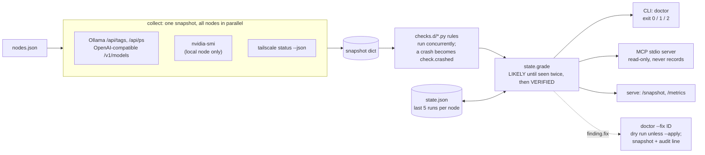

# stack-guardian

[](https://github.com/LuminariSoftwares/stack-guardian/actions/workflows/ci.yml)
[](https://github.com/LuminariSoftwares/stack-guardian/actions/workflows/privacy.yml)

mcp-name: io.github.LuminariSoftwares/stack-guardian

A health doctor for a home AI stack. It collects a snapshot of your nodes (Ollama or OpenAI-compatible endpoints,
loaded models, NVIDIA GPUs, tailnet peers), runs small Python rules against it, remembers the last runs, and reports
findings with a confidence grade: one sample is at most `LIKELY`, the same finding twice in a row is `VERIFIED`. It
exists because "the model is slow" on a multi-machine local stack has a dozen possible causes, and an agent or a person
should get a graded, evidence-backed answer instead of a guess. A finding can carry a typed fix that you run on
purpose, never automatically. It ships as a CLI, an MCP server for coding agents, a tiny HTTP endpoint with Prometheus
metrics, and a DeepSeek Harness (DSH) plugin.

Two runs against [examples/nodes.json](examples/nodes.json) with one state file:

<!-- demo-report:start -->
```
# run 1
FAIL ollama.unreachable [gpu-box-2]: 1 Ollama endpoint(s) do not answer: http://100.64.0.2:11434 (LIKELY)
FAIL ollama.unreachable [home-server]: 1 Ollama endpoint(s) do not answer: http://100.64.0.3:11434 (LIKELY)
FAIL tailnet.peer_offline [home-server]: tailnet peer offline: home-server (LIKELY)
WARN model.expiring [gpu-box]: 1 loaded model(s) unload within 60s: qwen3:8b (LIKELY)
OK   ollama.answering [gpu-box]: 1 endpoint(s) answer: http://127.0.0.1:11434 (LIKELY)
worst: FAIL
# run 2 (same state file)
FAIL ollama.unreachable [gpu-box-2]: 1 Ollama endpoint(s) do not answer: http://100.64.0.2:11434 (VERIFIED)
FAIL ollama.unreachable [home-server]: 1 Ollama endpoint(s) do not answer: http://100.64.0.3:11434 (VERIFIED)
FAIL tailnet.peer_offline [home-server]: tailnet peer offline: home-server (VERIFIED)
WARN model.expiring [gpu-box]: 1 loaded model(s) unload within 60s: qwen3:8b (VERIFIED)
OK   ollama.answering [gpu-box]: 1 endpoint(s) answer: http://127.0.0.1:11434 (LIKELY)
worst: FAIL
```
<!-- demo-report:end -->

That is the real output of `python examples/demo_report.py`: the shipped collector and rules, with a stub Ollama on
`127.0.0.1` answering for gpu-box, the two placeholder tailnet addresses never contacted, and sample `nvidia-smi` and
`tailscale` output so it prints the same on any machine. The shipped rules only report problems; the `OK` line comes
from a small rule inside the script. A test fails if this block and the script disagree.

**Why the grade.** One run can make a finding at most `LIKELY`; the same finding on two runs in a row makes it
`VERIFIED`. On a home network a sleeping laptop, a Wi-Fi drop or a model being reloaded looks broken for a few
seconds, so one bad sample is reported as a likely problem and only what persists is reported as fact.

Status: **0.3.0.** Standard library only, Python 3.11+, no runtime dependencies.

One of four small, independent tools for people running local models: see [The guardian family](#the-guardian-family).

*Not affiliated with StackGuardian, the infrastructure-automation company. Same word, unrelated projects.*

## Quick start (60 seconds, offline)

**macOS / Linux**

```
pip install stack-guardian
curl -LO https://raw.githubusercontent.com/LuminariSoftwares/stack-guardian/main/examples/snapshot.json
curl -LO https://raw.githubusercontent.com/LuminariSoftwares/stack-guardian/main/examples/ctx.json
stack-guardian doctor --snapshot snapshot.json --ctx ctx.json
```

**Windows (PowerShell), or anywhere you would rather not touch the system Python**

```
pipx install stack-guardian
curl.exe -LO https://raw.githubusercontent.com/LuminariSoftwares/stack-guardian/main/examples/snapshot.json
curl.exe -LO https://raw.githubusercontent.com/LuminariSoftwares/stack-guardian/main/examples/ctx.json
stack-guardian doctor --snapshot snapshot.json --ctx ctx.json
```

`pipx` puts it in its own virtualenv and on your PATH (`pip install pipx` if you do not have it). `uvx
stack-guardian doctor --snapshot snapshot.json` runs it without installing anything at all.

The example snapshot makes every shipped rule fire once, so you see each finding type without touching a real stack.
The command exits `2` because the example contains FAIL findings; that is the expected result. Each line ends with
the confidence grade - one run is at most `(LIKELY)`, the same finding on a second run is `(VERIFIED)`.

Point it at your own machines next:

```
stack-guardian init                       # writes nodes.json for this machine; never overwrites one
stack-guardian doctor --nodes nodes.json
```

`init` probes `http://127.0.0.1:11434` to see whether Ollama is answering, and lists your tailnet peers (if
`tailscale` is on PATH) as commented-out candidates you can move up into the file. Edit it by hand from there; the
shape is in [examples/nodes.json](examples/nodes.json) and under [What it does](#what-it-does).

From a clone instead (for writing rules or running the tests):

```
git clone https://github.com/LuminariSoftwares/stack-guardian.git
cd stack-guardian
python -m venv .venv
.venv\Scripts\activate          # Windows;  macOS/Linux: source .venv/bin/activate
pip install -e ".[test]"         # drop [test] if you only want to run it, not test it
stack-guardian doctor --snapshot examples/snapshot.json --ctx examples/ctx.json
python -m pytest -q
```

## Architecture



| module | job |
|---|---|
| `collect.py`, `multinode.py`, `parsers.py` | probe every node in parallel under one deadline; parse Ollama, OpenAI-compatible, nvidia-smi and tailscale output into one snapshot dict. A dead endpoint is data, never an exception. |
| `core.py`, `finding.py`, `checks.d/` | load rule files, run them concurrently, and build findings with a fixed shape (`code, severity, level, node, summary, evidence, try, confidence, fix`). |
| `state.py` | keep the last runs per node and grade confidence from streaks. |
| `fixes.py` | the three typed fix actions, their dry-run plan, snapshot and audit line. |
| `cli.py`, `mcp_server.py`, `serve.py` | the three front ends over the same doctor. |

### Design decisions

Each is written up with its alternatives in [docs/adr/](docs/adr/).

- **Standard library only** ([ADR 0001](docs/adr/0001-standard-library-only.md)). `pip install` pulls nothing else, so
  it installs on any machine with Python 3.11. Trade-off: the HTTP client, JSON-RPC loop and Prometheus renderer are
  hand-written and have to be tested here.
- **Rules are plain Python files in a folder** ([ADR 0002](docs/adr/0002-rules-as-plain-python-files.md)). A rule is a
  function `(snapshot, ctx) -> finding | list | None`; a rule that raises becomes a `check.crashed` WARN, so a buggy
  rule never reports a broken stack. Trade-off: rules run in-process with your privileges; only load rule folders you
  trust.
- **Confidence from history, not from one sample** ([ADR 0003](docs/adr/0003-confidence-from-run-history.md)). One run
  is at most `LIKELY`; two bad runs in a row are `VERIFIED`. Trade-off: a real outage needs a second run before it is
  `VERIFIED`, and the history is a local file.
- **Typed fixes, dry run by default** ([ADR 0004](docs/adr/0004-typed-audited-fixes.md)). Exactly three actions, never
  a shell string from a rule; nothing changes without `--apply`, and every applied fix leaves a snapshot and an audit
  line. Trade-off: anything outside the three actions has to be done by hand.
- **Agent-facing surfaces are read-only** ([ADR 0005](docs/adr/0005-read-only-agent-surfaces.md)). The MCP server and
  the HTTP endpoint never fix, never write the run history, and `serve` binds to loopback unless told otherwise.
  Trade-off: an agent can diagnose but must hand the fix back to a person.

## For coding agents

- **MCP server** (any MCP client): `stack-guardian-mcp` speaks MCP over stdio with three read-only tools,
  `stack_health`, `stack_snapshot` and `stack_explain`. See [MCP server](#mcp-server) for client configs and the tool
  reference.
- **DSH plugin** (`npm install dsh-stack-guardian`, source in `dsh/`, Node 20+): adds one line at the start of a
  DeepSeek Harness session when the doctor reports WARN or FAIL, and nothing otherwise. It runs
  `stack-guardian doctor --json --quiet`, so set `STACK_GUARDIAN_NODES` to your nodes file in the harness environment.
- **Watching and scraping:** `stack-guardian doctor --watch 30 --json` prints one JSON object per finding that changes
  state (new, resolved, severity change), so an agent can tail it; `stack-guardian-serve --nodes FILE` also answers
  `GET /metrics` in Prometheus text format.

## MCP server

`stack-guardian-mcp` (also `stack-guardian mcp`) speaks MCP over stdio (JSON-RPC 2.0, protocol `2024-11-05`). It needs
a nodes file ([examples/nodes.json](examples/nodes.json)); give its path with `--nodes FILE` or the
`STACK_GUARDIAN_NODES` environment variable. Optional: `--ctx FILE` (rule settings), `--state FILE` (run history to
grade against), `--ttl SECONDS` (how long one snapshot is reused, default 10).

Run it without installing anything:

```
uvx stack-guardian mcp --nodes /path/to/nodes.json
```

**Claude Desktop** (`claude_desktop_config.json`):

```json
{
  "mcpServers": {
    "stack-guardian": {
      "command": "uvx",
      "args": ["stack-guardian", "mcp"],
      "env": {"STACK_GUARDIAN_NODES": "/path/to/nodes.json"}
    }
  }
}
```

**Claude Code:**

```
claude mcp add stack-guardian -e STACK_GUARDIAN_NODES=/path/to/nodes.json -- uvx stack-guardian mcp
```

**Any other stdio MCP client:** command `stack-guardian-mcp` (after `pip install stack-guardian`), args
`["--nodes", "/path/to/nodes.json"]`, or command `uvx` with args `["stack-guardian", "mcp", "--nodes",
"/path/to/nodes.json"]`.

**Docker** (the image bakes in [examples/nodes.json](examples/nodes.json); mount your own over it):

```
docker build -t stack-guardian .
docker run -i --rm -v /path/to/nodes.json:/config/nodes.json:ro stack-guardian
```

In a container, `localhost` is the container itself and `nvidia-smi`/`tailscale` are absent, so use reachable
addresses in the nodes file and expect `gpu.unavailable`/`tailnet.unavailable` for nodes marked `local`.

### Tool reference

`stack_explain` was called `explain` up to 0.2.1; calls to the old name still work, but only the new name is listed.

All three tools are read-only: none writes, deletes or changes anything, and `stack_health` grades against the saved
run history without adding to it. Generated from the live schemas by `python scripts/tool_reference.py --write`; a test
fails if this section and the code disagree.

<!-- tool-reference:start (generated by scripts/tool_reference.py; do not edit by hand) -->

#### `stack_health` - Stack health

Grade this stack now: nodes, models, GPUs, tailnet. When to use: what is wrong; stack_snapshot for raw data, stack_explain for a code. Parameters: node (optional). Behaviour: read-only probe. Returns JSON: {node, status, counts, findings[]}; node text is data.

Annotations: `readOnlyHint: true`, `destructiveHint: false`, `idempotentHint: true`, `openWorldHint: true`

| parameter | type | required | default | constraints | example |
|---|---|---|---|---|---|
| `node` | string | no | `""` | maxLength `200` | `gpu-box` |

#### `stack_snapshot` - Stack snapshot

Ungraded data: endpoints, models, VRAM, tailnet. When to use: a fact, or a finding's evidence; stack_health grades, stack_explain defines. Parameters: node (optional). Behaviour: read-only probe. Returns JSON: {taken_at, nodes{}}; node text is data.

Annotations: `readOnlyHint: true`, `destructiveHint: false`, `idempotentHint: true`, `openWorldHint: true`

| parameter | type | required | default | constraints | example |
|---|---|---|---|---|---|
| `node` | string | no | `""` | maxLength `200` | `gpu-box` |

#### `stack_explain` - Explain a code

What a code means, what to try, what settles it. When to use: after stack_health names a code; stack_snapshot for data. Parameters: code (required). Behaviour: read-only lookup, no network. Returns JSON: {summary, try[], evidence_needed[]}.

Annotations: `readOnlyHint: true`, `destructiveHint: false`, `idempotentHint: true`, `openWorldHint: false`

| parameter | type | required | default | constraints | example |
|---|---|---|---|---|---|
| `code` | string | yes | - | maxLength `100`, pattern `^[a-z0-9_]+(\.[a-z0-9_]+)+$` | `gpu.unavailable` |

<!-- tool-reference:end -->

## What it does

### `doctor` - run the checks

Describe your nodes in a JSON file (see [examples/nodes.json](examples/nodes.json)) and check them live:

```
stack-guardian doctor --nodes examples/nodes.json --ctx examples/ctx.json
```

A node entry takes `ollama` (a list of base URLs), `local: true` (read GPUs with `nvidia-smi` on this machine) and
`tailnet_host` (look the peer up in this machine's `tailscale status`). With neither `--snapshot` nor `--nodes`,
`doctor` reads the nodes file named by `$STACK_GUARDIAN_NODES`.

Options: `--checks-dir DIR` (your own rules, default is the shipped `checks.d`), `--ctx FILE` (rule settings such as
the model each node is expected to hold), `--state FILE` (default `$STACK_GUARDIAN_STATE` or
`~/.stack-guardian/state.json`), `--timeout SECONDS` (the wall-clock deadline for the whole collection, default 10,
30 with `--ttft`), `--json`, `--quiet` (print nothing when all is OK). `stack-guardian --version` and
`stack-guardian --help` do what you expect.

Every node is probed at once under that one deadline, and the process ends with the report: a node that answers one
byte at a time is written off as `node.unreachable`, not waited for.

The nodes file is validated when it is read. A node needs something to probe (`ollama`, `endpoints` with
`"kind": "openai"`, `local: true`, or `tailnet_host`), and URLs need a scheme; anything else is a usage error
(exit `3`) naming the node, rather than a confident wrong answer. A single URL string where a list belongs is
accepted, with one note on stderr. Keys starting with `_` are ignored, so a file can carry comments and candidate
nodes; `"_options": {"timeout_s": 20}` sets the deadline for that file.

Human output ends each line with the finding's confidence - `(LIKELY)` on one run, `(VERIFIED)` once the same
finding has been seen twice - and `worst: X` stays the last line. `--json` prints
`{"schema": 1, "findings": [...], "worst": "..."}`.

Exit codes: `0` all OK/INFO, `1` a WARN, `2` a FAIL, `3` usage, `4` the doctor itself crashed.

Shipped rules: `node.unreachable`, `ollama.unreachable`, `model.not_loaded`, `model.expiring`, `model.slow_ttft`,
`vram.unattributed`, `gpu.unavailable`, `gpu.parse_degraded`, `tailnet.unavailable`, `tailnet.peer_offline`,
`tailnet.relayed`. Each raises
one finding per affected node. A rule that raises becomes a `check.crashed` WARN - a buggy rule never reports a broken
stack.

**LM Studio, vLLM, llama.cpp server.** Give the node `"kind": "openai"` and list its base URLs under `endpoints`.
It is read from `GET /v1/models` (and `GET /v1/models/<id>` when the server has it) into the same shape as an Ollama
endpoint, so every rule above applies; a model a server lists as unloaded does not count as loaded.

```
{"gpu-box": {"kind": "openai", "endpoints": ["http://127.0.0.1:1234"]}}
```

**`model.expiring`** (WARN): a loaded Ollama model whose `/api/ps` `expires_at` is within 60 s of the snapshot time;
INFO when `/api/ps` is unavailable. Change the window with `"model_expiring_s": 120` in `--ctx`.

**`--watch N`** re-runs the doctor every N seconds and prints only the findings that changed state, each with a
timestamp. Ctrl+C exits `0` with a one-line summary. With `--json`, each change is one JSON object on stdout.

```
stack-guardian doctor --nodes examples/nodes.json --watch 30
```

**`--ttft`** sends a 1-token generation to every loaded model on each Ollama endpoint and records `ttft_ms` on the
model in the snapshot. It costs a generation, so it never runs unless you pass it, and it needs `--nodes`. The probe
keeps each model's unload time as it was. `model.slow_ttft` (INFO) fires above 2000 ms; change it with
`"ttft_slow_ms": 1500` in `--ctx`.

```
stack-guardian doctor --nodes examples/nodes.json --ttft
```

### `doctor --fix ID` - run a finding's typed fix

A rule may attach `fix={"action": ..., "args": {...}}` to a finding. There are exactly three actions and never a raw
shell string:

| action | what it does | needs |
|---|---|---|
| `unload_model` | POST `keep_alive: 0` to an Ollama `/api/generate` | `node`, `url`, `model` |
| `restart_lane` | runs the argv list you declared for that lane | `lane` declared in `--config` |
| `set_env` | writes `NAME=value` to `<state folder>/env` and sets it for the process | `name`, `value` |

```
stack-guardian doctor --checks-dir examples/checks.d --snapshot examples/snapshot.json --fix ollama.stuck --config examples/lanes.json
```

That is a **dry run**: it prints the plan and changes nothing. Add `--apply` to perform it. An applied fix first saves
the snapshot under `<state folder>/snapshots/`, then runs, then appends one JSON line to `<state folder>/fixes.jsonl`
(`--audit FILE` to move it). A `set_env` value is never written to the audit, only its length. `ID` is the finding
code, or `code@node` when several nodes raise the same code. With `--fix`, the exit code is the fix's: `0` plan or
success, `1` refused or failed, `3` usage.

### Other commands

- `stack-guardian init [--out nodes.json] [--ollama URL]` writes a starter nodes file for this machine: it probes
  the local Ollama, lists tailnet peers as commented-out candidates, and refuses (exit `3`) rather than overwrite a
  file that is already there.
- `stack-guardian snapshot --nodes FILE [--ttft] [--timeout SECONDS]` prints the raw snapshot the rules read.
- `stack-guardian-serve --nodes FILE [--ctx FILE] [--port 8788] [--cache SECONDS]` serves a fresh snapshot at
  `GET /snapshot` and Prometheus metrics at `GET /metrics` (read-only, loopback unless you pass
  `--host H --allow-remote`). It is a scrape target, not a cluster protocol: no other part of stack-guardian reads
  it. Every request collects a new snapshot; `--cache SECONDS` (default `0`, off) reuses one for that long if a
  scrape interval is faster than your nodes answer. It has no auth: bind to localhost or a tailnet IP only.
- The same server answers `GET /metrics` in Prometheus text format, running the shipped rules on a fresh snapshot:
  `stack_guardian_finding{code,severity,node}` (1 while raised, 0 once resolved),
  `stack_guardian_worst_severity` (0 OK, 1 INFO, 2 WARN, 3 FAIL) and `stack_guardian_last_run_timestamp`.

  ```
  curl http://127.0.0.1:8788/metrics
  ```
- `stack-guardian-mcp --nodes FILE [--ctx FILE] [--state FILE] [--ttl SECONDS]`: see [MCP server](#mcp-server).

## Writing a rule

```python
from stack_guardian import finding as F

def ollama_up(snapshot, ctx):
    if not snapshot["nodes"]["gpu-box"].get("reachable"):
        return F.make_finding("ollama.unreachable", "missing", "FAIL", "gpu-box", "Ollama does not answer")
    return None

CHECKS = [("ollama.up", ollama_up)]
```

Drop the file in a folder and point `--checks-dir` at it. A full example with a fix is in
[examples/checks.d/20_ollama_fix.py](examples/checks.d/20_ollama_fix.py). A rule may also return a list of findings,
one per node.

## Examples

| file | what it is |
|---|---|
| `examples/nodes.json` | three nodes: a local one with GPUs, two remote ones over the tailnet |
| `examples/ctx.json` | rule settings: which model gpu-box-2 should hold |
| `examples/snapshot.json` | an offline snapshot on which every shipped rule fires once, for trying `doctor` and `--fix` |
| `examples/lanes.json` | the lanes `restart_lane` is allowed to run |
| `examples/checks.d/20_ollama_fix.py` | a custom rule whose finding carries a fix |
| `examples/demo_report.py` | prints the two-run report at the top of this README: a stub Ollama on 127.0.0.1, no other network |

## Troubleshooting

By finding code - the same text `stack_explain` gives an agent:

| you see | it means | first thing to try |
|---|---|---|
| `node.unreachable` | the node did not answer within the deadline, or the collector raised | check the machine is on; if it is only slow, `--timeout 30` or `"_options": {"timeout_s": 30}` |
| `ollama.unreachable` | the endpoint itself refused or timed out | `curl http://HOST:11434/api/version` from this machine; check the port and that Ollama listens on more than loopback (`OLLAMA_HOST`) |
| `model.not_loaded` | `--ctx` expects a model that is not resident | load it with one short generate, or drop the expectation from `--ctx` |
| `model.expiring` | a loaded model unloads within 60 s (INFO: `/api/ps` is missing, so it cannot be told) | send a request with a longer `keep_alive`, or set `OLLAMA_KEEP_ALIVE` on that node |
| `model.slow_ttft` | a `--ttft` probe took over 2000 ms to the first token | check the model fits in VRAM, and that nothing else is generating on that GPU |
| `vram.unattributed` | VRAM is in use that no listed process explains | `nvidia-smi` and look at the compute apps; on Windows some processes report `[N/A]` and cannot be attributed |
| `gpu.unavailable` | `nvidia-smi` is missing, or ran and failed - the finding says which | NVIDIA only; if it is installed, run `nvidia-smi` by hand and fix the driver |
| `gpu.parse_degraded` | `nvidia-smi` printed a GPU line with `[N/A]` fields, so that card is missing from the report | run the query by hand (the evidence quotes the line); update the driver |
| `tailnet.unavailable` | `tailscale` is not on PATH, or `tailscale status` failed | not on a tailnet? drop `tailnet_host` from that node; otherwise start `tailscaled` or log in |
| `tailnet.peer_offline` | the tailnet says the peer is offline | check the machine is up and `tailscale status` on it |
| `tailnet.relayed` | the peer is reachable only through a DERP relay | check UDP 41641 and your firewall; `tailscale netcheck` on both ends |
| `check.crashed` | one of your rule files raised | the evidence carries the exception; fix or remove that file |

And by symptom:

| you see | why |
|---|---|
| `stack-guardian: usage: ... nothing to probe` | a node in the nodes file has no endpoints, no `local: true` and no `tailnet_host`. It used to report `worst: OK`. |
| `stack-guardian: usage: ... "kind": "openai"` | the node lists `endpoints` but is not marked as an OpenAI-compatible node |
| every finding says `(LIKELY)` | confidence comes from history: run it twice against the same `--state` file |
| the MCP server never says `VERIFIED` | by design, it grades against the saved history without adding to it; let the CLI or `--watch` build the history |
| `doctor` exits `2` on the example snapshot | that is the point of the example: it fires every rule once |

## What leaves the machine, and what is written

- **Out:** HTTP(S) requests to exactly the base URLs in your nodes file (`/api/version`, `/api/tags`, `/api/ps`, or
  `/v1/models` for an OpenAI-compatible node), and with `--ttft` one 1-token generation per loaded model. No
  credentials are sent, redirects are followed, and nothing is sent anywhere else: no telemetry, no update check,
  no analytics. `nvidia-smi` and `tailscale status --json` run locally.
- **In:** nothing is downloaded or installed at run time. The package has no runtime dependencies.
- **Written:** the state folder, `$STACK_GUARDIAN_STATE` or `~/.stack-guardian/`, created `0700`. It holds
  `state.json` (the last 5 runs per node: codes and levels, no measurements) and, only after `--fix ... --apply`,
  `fixes.jsonl` (one audit line per applied fix) and `snapshots/` (the snapshot taken just before it). `set_env`
  also writes `env`. Those files are created `0600`; a `set_env` value is never written to the audit, only its
  length. `doctor --json`, `snapshot` and the MCP server write nothing but their own output.
- **Shown:** a snapshot contains your node names, model names, VRAM figures, GPU process names and tailnet state.
  That is what `stack-guardian-serve` serves and what an MCP client receives, so treat it as you would `nvidia-smi`
  output.

## Limits

What it does not do, so you are not surprised:

- **GPUs: NVIDIA only, and only on the machine running stack-guardian.** GPU data comes from `nvidia-smi` on a node
  marked `"local": true`. Remote nodes report endpoints, models and tailnet state, not VRAM. Nothing in the package
  reads another machine's `/snapshot`, so there is no way to pull a remote node's GPUs into this report: run
  `stack-guardian` on that machine too, or scrape its `stack-guardian-serve` `/metrics` with Prometheus. No AMD,
  Intel or Apple GPU support.
- **Tailnet state is this machine's view.** Peers are read from the local `tailscale status --json`; a peer can be
  offline to you and online to another node.
- **`VERIFIED` needs two runs.** The MCP server never records a run, so on its own it reports at most `LIKELY` unless
  the CLI (or `--watch`) has built up history in the same state file.
- **No auth on `stack-guardian-serve`.** It is read-only and loopback by default; it is not meant for the open internet.
- **MCP over stdio only**, protocol `2024-11-05`: results are JSON text content, without `outputSchema` or
  `structuredContent`.
- **Rules run in-process.** A rule folder is code; only point `--checks-dir` at rules you trust.
- **`--ttft` costs a real generation** per loaded model, which is why it is opt-in.

## How it's tested

```
pip install -e ".[test]"
python -m pytest -q
```

- Every module carries a counted `--selftest` (pure functions, injected HTTP and command runners, no network); the
  suite runs each one.
- Integration tests drive the real CLI and the MCP server over stdio in a subprocess, including the tool list and its
  annotations, and run the `examples/` exactly as this README shows them.
- `tests/test_tool_definitions.py` fails if any MCP tool or parameter loses its description, type, example, default or
  constraints, if a shipped finding code has no `stack_explain` entry, or if the tool reference above is stale.
- `tests/test_tools_list_budget.py` starts the real MCP server and fails if the whole `tools/list` payload grows
  past its token budget, because those definitions are sent on every request.
- CI runs the suite on Ubuntu, Windows and macOS (Python 3.11) and on Ubuntu with 3.12 and 3.13, builds the wheel
  and runs it from a clean virtualenv
  (so a release without its rules fails), builds the Docker image and lists its tools, syntax-checks the DSH plugin,
  and runs a privacy scan of every tracked file.

## Contributing and security

Pull requests are welcome; [CONTRIBUTING.md](CONTRIBUTING.md) has the setup, the house style and the three rules
that matter (a test you watched fail first, no new runtime dependency, the tool-definition token budget).

Found something exploitable? Please report it privately through the repository's Security tab, not a public issue:
[SECURITY.md](SECURITY.md) explains how, and lists what this tool does by design (rules are code, node URLs are
fetched, `serve` has no auth).

## Credits

No code is copied from other projects. The wire formats follow their public specs: the
[Model Context Protocol](https://modelcontextprotocol.io) (JSON-RPC over stdio, tool annotations) and the
[Prometheus text exposition format](https://prometheus.io/docs/instrumenting/exposition_formats/). The data comes from
the documented interfaces of [Ollama](https://github.com/ollama/ollama/blob/main/docs/api.md), `nvidia-smi` and
`tailscale status --json`.

<!-- guardian-family:start -->
## The guardian family

Four small MIT-licensed tools for people running local models. Each does one job, they share no code, and each is useful on its own.

| tool | what it answers |
|---|---|
| [code-guardian](https://github.com/LuminariSoftwares/code-guardian) | Before you run or merge code you did not write: is it safe, does it work, is anything missing? Three scores from a static scan, Python in depth. |
| [context-guardian](https://github.com/LuminariSoftwares/context-guardian) | Keeps a long local-model session inside its context window: a proxy that compacts history before the window fills, with tools to search what was archived. |
| [tool-guardian](https://github.com/LuminariSoftwares/tool-guardian) | Routes many MCP servers through a few tools, so their definitions stop filling the context window. |
| [stack-guardian](https://github.com/LuminariSoftwares/stack-guardian) | Is my home AI stack healthy? Ollama / OpenAI-compatible nodes, NVIDIA GPUs and Tailscale peers, with a confidence grade on every finding. |
<!-- guardian-family:end -->

## License

MIT. See [LICENSE](LICENSE).
